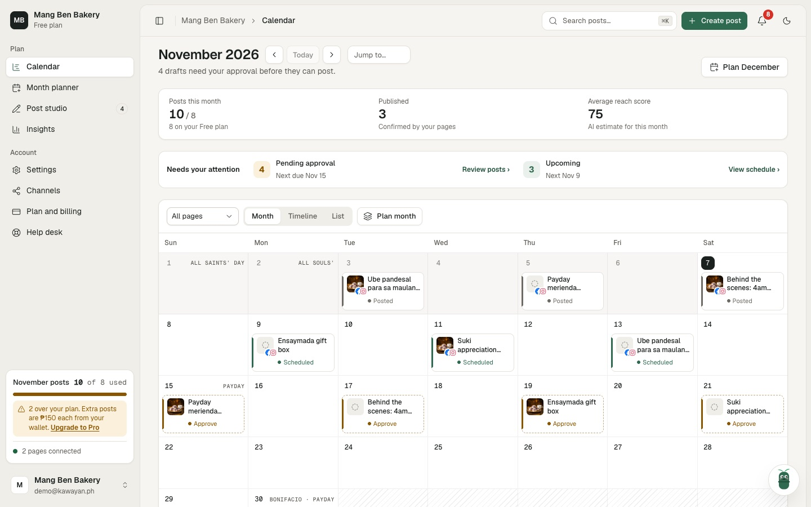
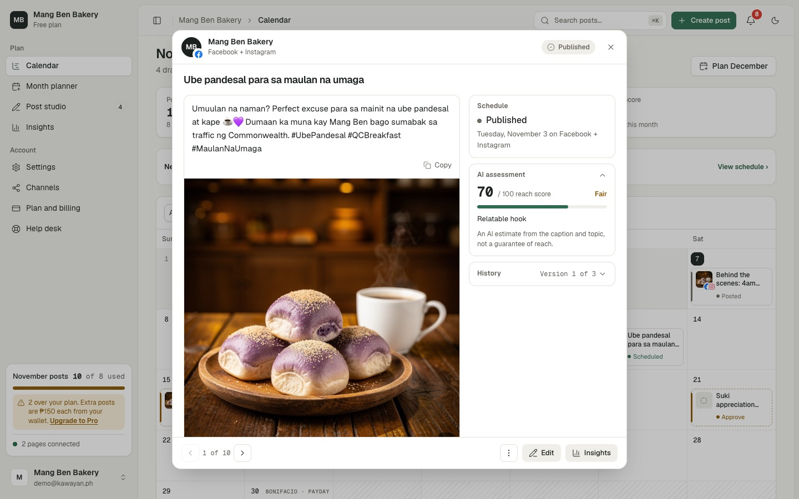
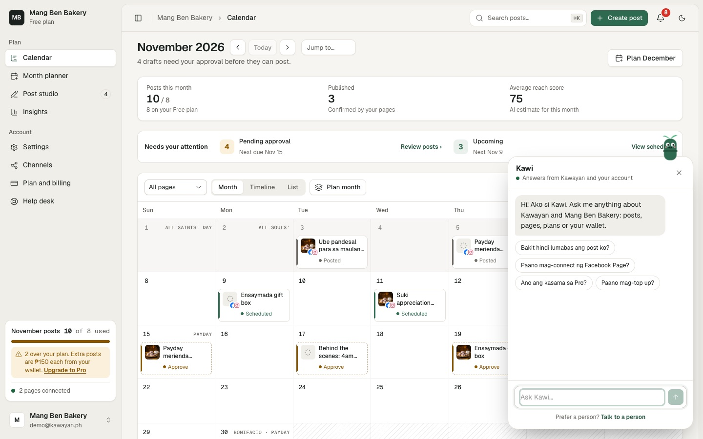
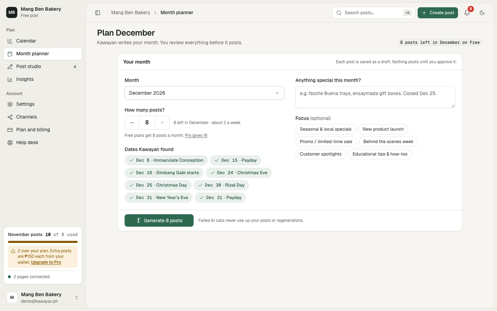
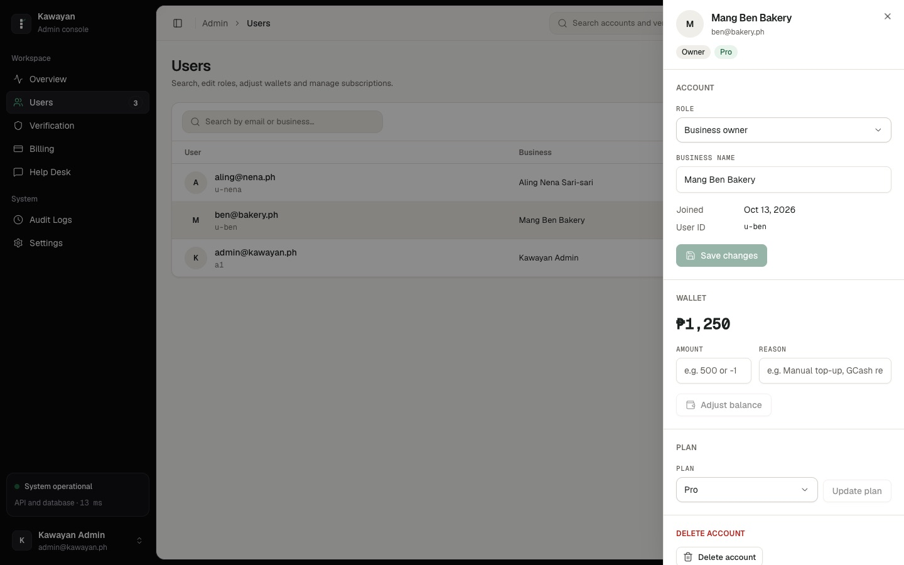

<div align="center">


# Kawayan AI

**Social media planning for Filipino small businesses.**
Kawayan writes a month of Facebook and Instagram posts in Taglish, with captions and images,
and schedules them once the owner approves.


</div>



## Overview

A sari-sari store, bakery or salon owner fills in a short brand profile once. From then on, Kawayan plans
the month around Philippine paydays and holidays, writes each post, draws its image, and puts everything
on a calendar. Nothing goes out until the owner approves it.

Kawayan is a capstone project that runs end to end: real accounts, a Postgres database, payments through
PayMongo (test mode), and publishing to connected Facebook Pages and Instagram accounts.

## Features

### For business owners

- **Brand DNA.** Industry, audience, brand voice, key themes, city and caption language (Taglish, English
  or Filipino). Every caption and image is written from it.
- **Month planner.** Pick a month and how many posts. Kawayan finds the paydays and holidays, takes notes
  like "Closed Dec 25", and writes each post as a draft with a caption, an image and a reach score.
- **Calendar.** Month, timeline and list views. Drafts can be dragged to another day, with undo.
  A "Needs your attention" bar shows only what needs action.
- **Post review.** Caption, image, schedule and the AI's reach assessment in one view. Approve and
  schedule, regenerate (two rewrites per post), edit by hand, or step to the next post.
- **Publishing.** Posts go to Facebook and Instagram through Zernio. If a page loses access, its posts
  are held until it's reconnected; failed posts return to drafts with a Retry button.
- **Insights.** How published posts performed, compared month to month.
- **Kawi, the help assistant.** Answers questions from a Kawayan fact sheet and the owner's own account
  ("why didn't my post go out?"), and hands the conversation to a person when asked.
- **Help desk.** Chat, voice calls and video calls with the support team.
- **Plans and wallet.** Free: 8 posts a month. Pro: ₱499 a month for 16. Extra posts cost ₱150 each from a
  wallet topped up with GCash, Maya or card.

### For the Kawayan team

- **Admin console.** Overview with a notification bell, a user list with a detail drawer (role, wallet,
  plan, delete), business permit review, payment verification and an audit log.
- **Support dashboard.** A ticket inbox with assignments, labels, canned replies and internal notes.
  Conversations handed over by Kawi arrive with a short summary.

<table>
  <tr>
    <td width="50%"><br><sub><b>Post review.</b> Approve, regenerate or edit a draft.</sub></td>
    <td width="50%"><br><sub><b>Kawi.</b> Answers from Kawayan and the owner's account.</sub></td>
  </tr>
  <tr>
    <td width="50%"><br><sub><b>Month planner.</b> One card, then posts appear as they're written.</sub></td>
    <td width="50%"><br><sub><b>Admin console.</b> Every account control lives in one drawer.</sub></td>
  </tr>
</table>

<sub>Screenshots use sample data.</sub>

## How a post is made

1. **Plan.** The month planner asks the text model for post ideas tied to the brand, the month's paydays
   and holidays, and the owner's notes.
2. **Write.** For each idea, one call returns the caption, an image prompt, a reach score and the reason
   for it, as JSON. The prompt keeps captions local, caps emojis at two, and never invents prices or promos.
3. **Draw.** The image prompt goes to the image model for a 1:1 picture with no text in it.
4. **Review.** The post is saved as a draft. The owner approves it, edits it, or asks for a rewrite.
5. **Publish.** Approved posts are scheduled to the connected pages and published at their time.

Each AI step falls back to the next provider if one is down or out of quota:

| Step | First choice | Fallbacks |
| --- | --- | --- |
| Text (plans, captions, Kawi) | Azure OpenAI `gpt-5-mini` | Groq `gpt-oss-120b`, then Cloudflare Workers AI |
| Images | Azure `FLUX.2 [pro]` | Cloudflare Stable Diffusion XL, then Pollinations |

## Tech stack

| Layer | Tools |
| --- | --- |
| Frontend | React 19, TypeScript, Vite 6, Tailwind CSS 4, shadcn/ui on Base UI, Motion, Recharts |
| Backend | Express 5 (run with tsx), Zod request validation, Socket.IO for live updates |
| Data | Supabase (Postgres and Storage) |
| Auth | JWT sessions, bcrypt; admin and support roles are re-checked on every request |
| Chat and calls | Stream |
| Payments | PayMongo (GCash, Maya, cards) |
| Publishing | Zernio (Facebook Pages, Instagram) |
| Email | Resend |
| Hosting | Render (`render.yaml`) |

## Getting started

You need Node 20 or newer and a Supabase project.

```sh
git clone https://github.com/jhanric-pablo/kawayan-ai.git
cd kawayan-ai
npm install
cp .env.example .env      # then fill it in (see below)
```

In the Supabase SQL editor, run `scripts/supabase_schema.sql` (safe to run again). Then start the app
and the API together:

```sh
npm run dev:full
```

The app opens at <http://localhost:3000> and the API runs on port 3001.

### Environment variables

Only Supabase and `JWT_SECRET` are required to start. Each of the rest turns on a feature, and every
variable has a comment in [`.env.example`](.env.example) explaining where to get it.

| Variables | What they turn on |
| --- | --- |
| `SUPABASE_URL`, `SUPABASE_SERVICE_ROLE_KEY`, `SUPABASE_ANON_KEY` | **Required.** Database and file storage |
| `JWT_SECRET` | **Required.** Sign-in sessions |
| `AZURE_OPENAI_ENDPOINT`, `AZURE_OPENAI_API_KEY`, `AZURE_TEXT_MODEL` | Captions, plans, Kawi and FLUX.2 images |
| `GROQ_API_KEY` | Faster backup for text |
| `CLOUDFLARE_ACCOUNT_ID`, `CLOUDFLARE_API_TOKEN` | Free backup for text and images |
| `STREAM_API_KEY`, `STREAM_API_SECRET` | Help desk chat, voice and video calls |
| `PAYMONGO_SECRET_KEY` | Plan payments and wallet top-ups |
| `ZERNIO_API_KEY` | Publishing to Facebook and Instagram |
| `RESEND_API_KEY`, `MAIL_FROM`, `APP_URL` | Password reset and verification emails |

`.env` is ignored by git. Keys stay on the server; the browser only receives short-lived tokens.

### Scripts

| Command | What it does |
| --- | --- |
| `npm run dev:full` | App and API together, with reload |
| `npm run dev` | App only (Vite) |
| `npm run server` | API only, restarts on change |
| `npm run typecheck` | Type-check without building |
| `npm run build` | Production build into `dist/` |
| `npm start` | Serve `dist/` and the API from one process |
| `npx tsx tests/<name>.test.mjs` | Run one test file |

The tests are plain `node:assert` scripts for the logic that's easy to break: AI plan validation, plan
days, timeline lanes, insights maths, admin jobs and URL paths.

## Project structure

```
src/
  components/        Screens by area: calendar, admin, kawi, settings, tour, landing, auth
  components/ui/     shadcn/ui components themed from src/styles/theme.css
  services/          Clients for AI, payments, social, support and Supabase
  utils/             Plan limits, insights maths, session and mail helpers
  styles/theme.css   Every color, font, radius and shadow token (light and dark)
server.js            Starts the API, serves the built app
server/
  routes/            One file per area: auth, posts, ai, images, payments, social, support, admin, verification
  kawiFacts.js       What Kawi knows about Kawayan
  shared.js          Auth and role checks, Zod validation, database client
  realtime.js        Socket.IO live updates
scripts/             Supabase schema
tests/               Test scripts
docs/screenshots/    Images used in this README
```

## Deploying

`render.yaml` describes the whole service, so Render can create it as a Blueprint. Set the environment
variables in the Render dashboard; `JWT_SECRET` is generated for you. The build installs dev dependencies
because `vite`, `tsx` and `typescript` are needed to build and run.

## Limitations

- PayMongo runs in test mode, so no real money moves.
- Publishing supports Facebook and Instagram only.
- Kawi answers 40 questions per account every 10 minutes, to keep AI costs predictable.
- Render's free plan sleeps when idle; the first request after a quiet period can take up to a minute.

## Developer

Designed and built by **Jhanric Pablo** ([@jhanric-pablo](https://github.com/jhanric-pablo)), sole
full-stack developer: frontend, backend, database, AI integration, payments and deployment.

## License

BSD 2-Clause. See [LICENSE](LICENSE).
